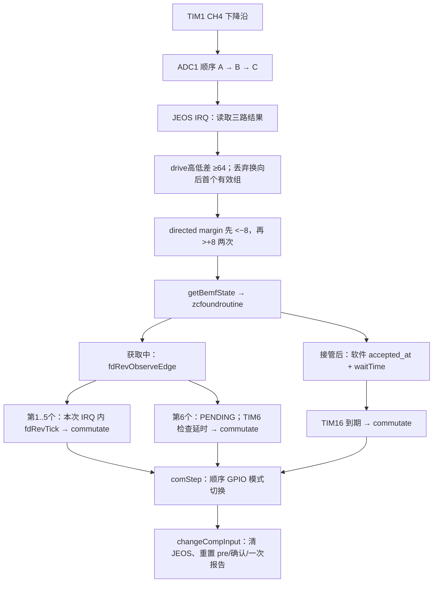

**S4V2：ADC 采样 → 过零判决 → 实际换向审计，2026-10-29**

审计对象为10月29日冻结状态；10月30日续核中断服务与 PWM 更新边界。

已按交接接手本地仓库。本轮没有修改控制源码、参数或保护，没有访问 MCU、烧录或驱动电机。只新增审计文档、证据及离线复现；单独重编译了一次 CUSTOM_FD6288_G431，用于确认源码与冻结固件一致。

**结论：尚未确认启动失败的物理根因，但已经定位到一个直接关联失败样本的接管语义差异，以及两个独立的时序完整性问题。**

最先应解决的是“公版启动接受什么反馈、当前移植接受什么反馈”的契约问题。公版前五次立即推进的输入是经过多次轮询确认的比较器后侧电平；当前输入是每个新扇区重新武装的 ADC 前侧→后侧事件。仅保留“前五次立即”这条语句，不代表复现了公版启动。不能因此直接删除 pre 武装：原生电平法的适用条件不能未经验证搬到三相顺序 ADC 上。

最新失败第 18 次在第一边沿之后，step3 有 539 个有效后侧样本、零个 pre，因而一直拒绝。它不是整扇区无采样，也没有走到第六边沿接管。第六边沿的调度问题不能解释这一次停在单边沿的失败。

**对照身份与真正启用的路径**

| 项目 | 固定依据 |
| --- | --- |
| 本地工作目录 | `/Users/nxf75465/codex/am32_on_omp_esc/AM32-main` |
| 本地 HEAD | `81676833be0d129a9cc4ff202d413ba78c502848`；保留全部原有未提交及未跟踪内容 |
| 冻结固件 | `test-firmware/fd6288-S4V2-LATEGATE-20261029/`，variant45 |
| HEX SHA256 | `ddb2c159a9af7f12f0935cc1848a733910461e32d7cded4167bfb403302a6434` |
| 源码对应性 | 按交接开关重编译到 `obj-audit-S4V2-20261029/`；HEX、BIN 均与冻结产物逐字节一致 |
| 公版 | 官方 [v2.21](https://github.com/am32-firmware/AM32/releases/tag/v2.21)，提交 `6b3ef3d15228e8d70244bd6e3bd87c7eac939d6f`，主要对照 `AIKON_SINGLE_F421` |
| 设置 | 最新 `capture-failure.bin.json` 的 `settings_hex`，SHA256 `df7d154afa92e60e2ba802766f9efaa19469e420059453a9d5c631c69fc5b1d0` |

公版提交由官方 tag 与 release 页相互核对；这不等于确认用户另一只 AIKON 电调的具体二进制、编译选项和设置。

冻结 ELF 的 DWARF 宏确认：`USE_ADC_ZCD`、`TARGET_ADC_ZCD_GUARD`、JEOS、ASYNC_COMM、NATIVE_EARLY、双定位、ACTUAL_DEADTIME 和 S4V2 重试路径启用。`ACQ_STATS=1` 又定义了 `TARGET_FD_SECTOR_DIAG`，所以不能看到 `SECTOR_DIAG=0` 就说没有扇区记录。`NO_DIAGNOSTICS=1` 关闭了完整 ADC/调度器耗时统计，但轻量试验记录、扇区统计、定位观察仍在。

`SEED_DELAY`、`PHASE_DELAY` 虽然定义，前五边沿的相应代码被 `!TARGET_FD_NATIVE_EARLY` 排除；当前没有首次 500µs 或第 2..5 次相位等待。PIN_SCAN、PIN_SYNC、EDGE_OBSERVE、PLANNED_ACQ 未启用。

设置解码：正向、单向、无正弦启动、互补 PWM 开、固定 24kHz、14 磁极；`advance_level=18`、`auto_advance=0`，实际 `temp_advance=8`。因此有效延时为周期的 `1/2−8/64=3/8`。这里只陈述保存的设置，没有改动设置。

完整哈希、开关、数据摘录见 [evidence.json](/Users/nxf75465/codex/am32_on_omp_esc/AM32-main/docs/audit-20261029/evidence.json)，冻结编译宏见 [frozen-elf-macros.txt](/Users/nxf75465/codex/am32_on_omp_esc/AM32-main/docs/audit-20261029/frozen-elf-macros.txt)。`Inc/targets/CUSTOM-FD6288-G431.h` 只是说明文件，实际目标定义在 `Inc/targets.h`。

**差异与证据表**

| 环节 | S4V2 源码事实 | 公版 v2.21 / 实测对照 | 判断与缺口 |
| --- | --- | --- | --- |
| 启动接受条件 | 每扇区清 pre；先 `<−8`，再连续两个 `>+8`；只报告一次 | AIKON 启动累计后侧电平，正常单向初期阈值为 `>6`，不要求先见 pre；失败 step3 的 539 个后侧样本全为 unarmed | **与失败直接相关的已证实差异**；未知后侧是正确位置、换向瞬态、模拟偏差还是别的电气状态 |
| 前五次“立即” | 两个新 PWM 样本确认之后，当前 ADC IRQ 内推进 | 公版通常在 20kHz 控制轮询累计七次后侧之后推进 | **立即的参考事件不同**；不能据此指定固定补偿时间或断言提前了多少 |
| 第六次换向 | 只设 `FD_REV_PENDING`，由 TIM6 检查延时到期；没有装载 TIM16 | 公版轮询路径读/清间隔计时器后等待到 waitTime；S4V2 后续闭环才用 TIM16 | **确定的调度差异**；理想检查量化约 0..51µs，另有阻塞；不能解释第18次最大连续1 |
| 采样→时间戳 | 时间戳在软件判决/策略入口取得，无采样年龄补偿 | 公版启动也用软件轮询时刻；运行比较器 IRQ 则没有三 rank 和 PWM 采样间隔 | **尚未获得真正电气过零时间**；需要触发轮次、样本时刻和最大服务延迟 |
| ADC 三路一致性 | 清 JEOS→依次读 JDR1/2/3→再查 JEOS | JDR 按各 rank 完成更新，JEOS 只表示整组完成；离线反例可让半更新三元组通过检查 | **静态一致性缺口，已用实际函数复现**；需证明实机延迟是否达到下一轮部分转换窗口 |
| PWM/采样参数一致性 | CCR1/2/3/4 逐个写预装载，关 CPU 中断没有阻止 TIM1 更新事件 | 若更新落在写入之间，可有一周期新 duty 配旧触发值；但正常 ±2 斜坡及定位→启动单调升幅的数字窗口仍成立 | **大幅降占空比时的边界风险**，本轮已降低其作为第18次失败原因的优先级；未观测到对应跳变 |
| 相序与极性 | step、浮空相、rising、raw COMP 取反一致 | 与公版六步相序相符 | 未发现软件相序表或多一次取反错误；不独立证明 PCB 接线 |
| GPIO 到功率桥 | 顺序切 GPIO 模式；PWM 载波自由运行，无统一硬件 COM 锁存 | 当前 comStep 顺序继承公版 G431；公版 F421 是每步 FLOAT→LOW→PWM | 不能把函数入口/日志时刻叫实际相电压换向时刻；需要区分寄存器写入与桥臂响应 |

**采样链路与数字时间预算**

配置入口：[ADC.c](/Users/nxf75465/codex/am32_on_omp_esc/AM32-main/Mcu/g431/Src/ADC.c:580)、[TIM1 初始化](/Users/nxf75465/codex/am32_on_omp_esc/AM32-main/Mcu/g431/Src/peripherals.c:226)、[采样窗口计算](/Users/nxf75465/codex/am32_on_omp_esc/AM32-main/Mcu/g431/Inc/peripherals.h:55)。

TIM1 为 160MHz、PSC=0、向上计数，固定 ARR=6665，周期 `(6665+1)/160MHz=41.6625µs`，即约 24.0024kHz。配置为 ADC1 injected 由 TIM1_CH4 下降沿触发，每个载波一组三相；不是 TIM6 发起，也不是 ADC regular DMA 三相采样。最新正常长度空扇区约 22.5ms 消费 540 组，与该速率一致，但总数不排除局部丢样。

ADC 同步 PCLK/4，即 40MHz、12bit；rank1/2/3 固定为 PA0(A)/PA1(B)/PA2(C)，各 6.5 周期采样，12.5 周期转换。温度在 ADC1 regular；PA5 电压与 PA6 电流在 ADC2 regular。

以下以真正触发时刻为零，L 是触发到采样开始延迟；三相不是同时采样。

| rank | 采样保持窗口，µs | 转换完成，µs | JEOS 时距该相保持结束，µs |
| --- | --- | --- | --- |
| A | L .. L+0.1625 | L+0.475 | 1.2625 |
| B | L+0.475 .. L+0.6375 | L+0.950 | 0.7875 |
| C | L+0.950 .. L+1.1125 | L+1.425 | 0.3125 |

按 [ST DS12589 Rev6，表60，第119页](https://www.st.com/resource/en/datasheet/stm32g431cb.pdf#page=119)，CKMODE=11 且不打断正在进行的 regular 转换时，最大 L=2.125 ADC 周期；打断 regular 时最大 L=3.125 周期，即 0.078125µs。因此当前配置模型下，触发至 JEOS 最大为 `57+3.125=60.125` ADC 周期，即 1.503125µs / 240.5 个 TIM1 tick。代码留 244 tick（1.525µs），**数字转换时间预算够用**。这不含 GPIO、FD6288、功率器件和分压网络的模拟稳定时间。

最终死区码是 0xCE，按编码解算为 368 tick=2.3µs，不能直接用 `DEAD_TIME=70`。采样起点下限为 460 tick=2.875µs，最小 compare 为 704 tick=4.4µs。CCR4 算法为 `clamp(duty/2,460,duty−244)`，窄于704时返回0；驱动输出路径又把有效 compare 下限夹到704。

在稳定设置且完整同周期预装载成立时，请求占空比210/360/400（分母2000）分别得到 compare704/1200/1334，CCR4为460/600/667。数字模型把三 rank 放在导通段内；最小脉冲处留给模拟稳定与末端裕量很有限，不能由该算式证明实际分压已稳定。

本轮核对到的硬件触发选择是 JEXTSEL=1/TIM1_CH4，CH4=PWM1/高有效，JEXTEN=下降沿；设计触发点是 CNT=CCR4。本轮没有硬件触发锁存或示波数据来独立标定实际相位，不能用 ISR 中读出的 CNT 反推三个 rank 的精确时刻。CCR 有预装载时，软件读回的 CCR 还可能是待更新值，未必是本次转换使用的活动值。

虚拟中性点是 `floor((A+B+C)/3)`，没有每路增益/偏置校准。三个 rank 跨约0.95µs，驱动高低差 `>=64` 只是数字有效性条件；它没有证明三路模拟值来自稳定导通段。代码注释中的“同分压比例即可独立于分压和母线”应理解为理想同刻/同比例模型，不能代替实际标定证据。

**判决、消隐与换向路径**



判决实现：[comparator.c](/Users/nxf75465/codex/am32_on_omp_esc/AM32-main/Mcu/g431/Src/comparator.c:159)。`directed = rising ? 浮空相−中性点 : 中性点−浮空相`。

| step | PWM相 | 接低相 | 浮空相/rank | 正向浮空电压方向 |
| --- | --- | --- | --- | --- |
| 1 | A | B | C/3 | 上升 |
| 2 | C | B | A/1 | 下降 |
| 3 | C | A | B/2 | 上升 |
| 4 | B | A | C/3 | 下降 |
| 5 | B | C | A/1 | 上升 |
| 6 | A | C | B/2 | 下降 |

反向递减 step 且 rising 取反；ADC 输出模拟“中性点在 COMP 正端、相电压在负端”，主程序再取反。这条软件链没有发现极性错配。

每次 `changeCompInput` 清 JEOS、把 blank 置1、清 before_seen/confirmations/reported。blank 只由有效新组消耗；若此时有转换正在进行，并没有取消 ADC 转换或给它附上 sector_epoch，而是靠丢弃下一个有效组隔离边界。丢弃组中的 pre 不会武装。

获取期间 `adc_zcd_earliest=0`，不是运行期半周期门限把本例挡住。由于获取期 `commutation_interval` 仍为人工种子10000，即使 `fd_rev.measured` 已变短，确认次数仍为2；接管后按间隔 `<2000` tick（1ms）才降到1。无效新样本和滞环区会清确认次数；每扇区接受一次后不再报告。外层 TARGET_MIN_BEMF_COUNTS=0，接受后的 bemfcounter=1 即可进入 zcfoundroutine，未发现双重累计要求。

在已经武装、样本有效、无中断阻塞的假设下，实际电压跨过 `+8` 到第二个 post 被采到，仍有约1..2个 PWM 周期的离散延迟；另外还包括 rank 后续转换、IRQ 等待与软件处理。从真实零电压差到 `+8` 还存在与斜率有关的滞环延迟，不能统一扣一个固定微秒数。

**公版启动的关键语义**

官方源码：[getBemfState](https://github.com/am32-firmware/AM32/blob/6b3ef3d15228e8d70244bd6e3bd87c7eac939d6f/Src/main.c#L822)、[zcfoundroutine](https://github.com/am32-firmware/AM32/blob/6b3ef3d15228e8d70244bd6e3bd87c7eac939d6f/Src/main.c#L1624)、[初期计数阈值](https://github.com/am32-firmware/AM32/blob/6b3ef3d15228e8d70244bd6e3bd87c7eac939d6f/Src/main.c#L1947)。

AIKON_SINGLE_F421 使用内置比较器，comStep 切换浮空相比较器输入。启动轮询只看当前电平：后侧加 bemfcounter，错误电平累计到一定次数才清计数；没有“换向后必须先看到前侧”的状态。普通单向初期 TARGET_MIN_BEMF_COUNTS=3，阈值乘2，条件是大于6。若七次一直后侧，理想轮询耗时从首次观察起306µs；从任意电平到达时刻算约306..357µs，实际受调度影响。这不是七次独立模拟转换。

当前两次 post 必须来自不同 PWM 组，且前面已经出现 pre。其“立即”相对的是该 ADC 事件；公版“立即”相对的是累计电平判断。两者的拒绝条件和时间基准同时变了，因此既不能说当前就是公版启动，也不能把“公版能接受同侧”当成该同侧信号一定正确。

另一个差异是公版无反馈超时调用 zcfoundroutine 强制推进，更新 IIR，并把 zero_crosses 从0加到1。S4V2 的超时推进不伪造边沿、不更新边沿周期，获取连续计数重新归零；第二个被接受事件才建立相邻周期。当前策略的计数语义更明确，但与公版状态轨迹不同，不能作同参数等价对照。公版正常轮询也不是恒定“第六次切硬件 IRQ”：转入 IRQ 还取决于滤波间隔、stall/反向选项；AIKON target 没有定义 NO_POLLING_START。

**第六边沿与闭环换向的时间基准**

获取入口：[fdRevObserveEdge](/Users/nxf75465/codex/am32_on_omp_esc/AM32-main/Src/main.c:1341)、[第六边沿策略](/Users/nxf75465/codex/am32_on_omp_esc/AM32-main/Inc/fd6288_startup_sequence.h:432)、[fdRevTick 接管](/Users/nxf75465/codex/am32_on_omp_esc/AM32-main/Src/main.c:1225)。

第1..5次 s->delay=0，本次 ADC IRQ 会经 fdRevTick 立即调用 commutate。第6次 delay=3/8×measured，第一次 fdRevTick 只检查未到期；后续由 tenKhzRoutine 中的 fdRevTick 等待到期。TIM6 为1MHz计数、ARR=50，理想周期51µs。这里没有 TIM16 deadline，也不受闭环 fdAsyncTooLate 的50µs迟到检查。ADC、TIM6、TIM16 同优先级0及关中断段还会增加延迟，所以51µs不能作为实机最坏上界。

接管后，[zcfoundroutine](/Users/nxf75465/codex/am32_on_omp_esc/AM32-main/Src/main.c:2948) 在进入函数、经过 fdBenchService 后读取 DWT 作为 accepted_at，并读/清 TIM2。它更新周期一次，然后以 `accepted_at + waitTime×80` 提交 TIM16；编程时扣掉已经消耗的 DWT 时间，ARR用向上取整tick减1。没有再走旧忙等/原生 PeriodElapsedCallback 的第二次滤波。

[fdAsyncTimer](/Users/nxf75465/codex/am32_on_omp_esc/AM32-main/Src/main.c:1733) 复核 pending、epoch、方向、coast、运行门控，过早则重新装载，迟到超过8000 DWT周期则停机。它记录的 executed_at（若开启诊断）也在 commutate 之前；随后的 fdBenchService、comStep 和驱动传播没有计入这个记录。epoch 保护的是换向请求，不能据此推定 ADC 样本也带同样的世代身份。

GPIO 模式在任意载波位置切换，CCR1..3 的 PWM 仍继续运行；新相高侧能否立刻形成有效导通脉冲取决于当时 CNT/CCR 和死区。对某些新 PWM 相，可能要等到下一个脉冲；对另一些换向，改变的是静态低相。不能简单给每次 GPIO 换向都加一个固定载波周期。公版 G431 也用这类输出路径，本轮没有把这一点错误归为新引入的相序缺陷。

**最新失败的时间戳对齐**

原始记录：[capture-failure.bin.json](/Users/nxf75465/codex/am32_on_omp_esc/AM32-main/hardware-backups/S4V2-flash-p9VKCL/capture-failure.bin.json)。扇区记录起点为 DWT=50376906；轻量记录起点为50376963，二者相差57周期=0.35625µs。下表统一以扇区起点为零。

| 软件事件 | 时间，µs | 准确含义 |
| --- | ---: | --- |
| 第一驱动 step2 的 fdSectorStep | 90083.425 | comStep/changeCompInput 后发布扇区 |
| ADC 判决接受记录 | 92092.525 | comparator 已确认后传给 fdSectorSample 的软件时刻 |
| fdLightEdge | 92096.775 | 原轻量值92096.41875，加起点差；晚于策略入口 |
| 旧扇区关闭时刻 | 92098.5875 | fdRevTick 检查策略时取的 now，在实际 GPIO 写之前 |
| 下一 step3 的 fdSectorStep | 92104.900 | 下一组 GPIO 模式切换及检测器重置之后 |

因此这次接受记录到下一扇区发布相隔12.375µs。按调用顺序，可把本次 GPIO 写入界定在92098.5875..92104.900µs这个软件区间；它不是示波器测到的功率相电压边沿，也不包含触发至采样、转换及 IRQ 到达延迟。

step2 共49组：blank1、pre32、滞环14、confirmation1、accept1；有效 directed margin 为−22..12。这证明实际代码看到了所需序列，不能把首边沿直接定为噪声。随后 step3 共540组：blank1、unarmed539，margin124..197、pre0、invalid0、early0，直到约22.5ms超时。是否在消隐前已经越过 pre、是否信号本来就位于后侧、是否存在模拟偏差，现有统计不能区分。

第二轮后段没有完整扇区记录；总39扇区只存24。末次两轮各一个孤立接受事件、最大连续1、31次超时，820ms NO_LOCK。不能从缺失的15个扇区补造连续波形。

**数据一致性反例与范围**

[comparator.c:276](/Users/nxf75465/codex/am32_on_omp_esc/AM32-main/Mcu/g431/Src/comparator.c:276) 清 JEOS 后读 JDR，再查 JEOS，只能发现读快照期间又完成了整组。依据 [RM0440 的 JEOC/JDR 更新定义](https://www.st.com/resource/en/reference_manual/dm00355726.pdf#page=678)，各 rank 在各自完成时更新；[注入通道没有 overrun 检测](https://www.st.com/resource/en/reference_manual/rm0440-stm32g4-series-advanced-armbased-32bit-mcus-stmicroelectronics.pdf#page=640)。

静态反例：第n轮已完成、JEOS未处理；CPU一直等到第n+1轮A/B完成而C未完成才服务。清的是旧JEOS，读到的是新A/B+旧C，读后JEOS仍为0，因此现有检查放行。这不要求中断在三次读取之间抢占，ADC硬件会独立运行。

使用当前真实 comparator 函数、step3、两次确认构造：完整三元组依次为 `(0,600,1600)`、`(0,1000,2200)`、`(0,1400,3000)`，全部为 pre；若两次服务均落在上述半更新窗口，读取到 `(0,1000,1600)` 和 `(0,1400,2200)` 则成为连续 post，产生一次接受事件。离线测试通过。**这是代码不能保证三路一致的反例，不是第18次真实 ADC 数据，更不证明实机发生了这种延迟。**

该反例还需要较强的延迟前提。以连续触发且两轮 L 相同计算，从旧 JEOS 到下一轮 A 更新约40.7125µs，到 B 更新约41.1875µs，到 C 更新约41.6625µs；上述“新A/B+旧C”落在最后约0.475µs窗口。超过一轮时还有重复窗口。冻结 ELF 对应的预处理路径中，没有发现正常 DRIVE/获取路径明确等待多个 PWM 周期的忙等；获取切换有5µs全关等待。这个检查既不能证明存在上述延迟，也不足以给出最坏中断服务时间。必须测量最大服务/关中断时长，不能由源码行数或反汇编字节数推算一个可靠上界。

S4V2 的 irq_count、irq_max_cycles、sample_collisions、scheduled/executed/late_stop 等诊断更新被编译掉。capture 中相应零值不构成“没有碰撞、没有迟到”的证据；控制使用的 pending/deadline/epoch 仍然存在。

另一个独立边界是 CCR 预装载：`SET_DUTY_CYCLE_ALL` 没有禁止 TIM1 的硬件更新。冻结 ELF 的活动输出路径最终用四条相邻 STR 写 CCR1..4；如果周期更新落在这些写入之间，触发位置与本周期 duty 可以不是同一组参数。但参数不同步不自动等于窗口越界。

续核把这个风险缩小到更具体的条件：获取期 setpoint 被赋为 startup_floor，正常启动为400；正常 duty 斜坡每次最大变化2。调用实际 `zcd_ccr4_from_duty`，枚举1..2000内所有9994个 ±2（含0）有效变化，旧 trigger 加244 tick均不超过新旧任一 power compare；210..400的全部单调升幅也满足。因此正常斜坡和定位到启动的升幅不能仅因上述分批更新而使这份数字窗口失效。大幅下降如400→210可以构造越界：旧CCR4=667，新compare=704，`667+244>704`；没有证据表明第18次驱动期间发生了这种跳变。故本轮降低它作为本次失败原因的优先级，保留为突变/限幅路径的独立边界，不与 JDR 半更新混作一个问题。算式仍不验证模拟稳定时间。

**本轮验证与下一步取证边界**

单目标重编译成功，RAM7824B、FLASH代码38000B；既有 newlib 未实现系统调用及 RWX 链接警告仍在。没有新控制候选固件。现有 host 15变体、实际 async 调度器测试、S4V2 重试适配器测试均通过。它们覆盖软件条件、取消、回绕等，不验证模拟采样窗口、最大中断延迟或真实电机锁定。

新增离线 [replay.cjs](/Users/nxf75465/codex/am32_on_omp_esc/AM32-main/docs/audit-20261029/replay.cjs) 提取实际 ADC 与公版函数，验证“后侧平台的判决差异”和“半更新 JDR 反例”。在仓库根目录运行：

```sh
node docs/audit-20261029/replay.cjs docs/audit-20261029/upstream-v2.21-main.c
```

日志、固定公版源码副本及哈希均存于 `docs/audit-20261029/`。这是寄存器模型，不是电机仿真。

续核用 [pwm_window_check.cjs](/Users/nxf75465/codex/am32_on_omp_esc/AM32-main/docs/audit-20261029/pwm_window_check.cjs) 直接提取实际触发位置函数，完成上述占空比变化枚举；结果见 [pwm-window.log](/Users/nxf75465/codex/am32_on_omp_esc/AM32-main/docs/audit-20261029/pwm-window.log)。

当前证据不足以选择一个能解决启动失败的控制修正。下一份有价值的证据应限定在最后定位、第一接受事件和紧接的扇区：每个关键组的ABC、判决标签、触发轮次/时刻、软件到达时刻，以及 comStep 前后时刻。重点判断 pre 是物理上没出现，还是出现于消隐/丢样/错误窗口；同时取得最大 IRQ/关中断服务延迟，判断 JDR 反例的前提是否成立。软件 CNT/预装载 CCR 只能作为辅助，不能冒充硬件采样时间。

若后续实施基础链路修正，方向应是保证同一轮三路数据、明确样本年龄、统一第六边沿和闭环的定时执行语义；这些与增设失败补救分支是不同工作。本轮没有实施这些修正，也不据此要求用户进行新一轮盲测。
